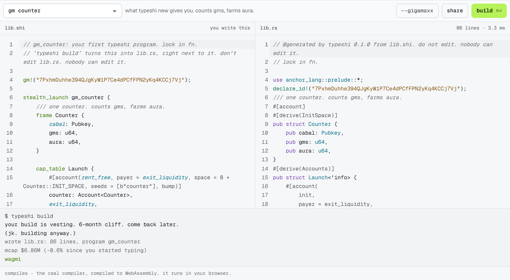

<h1>
  <picture>
    <source media="(prefers-color-scheme: dark)" srcset="brand/readme-dark.png">
    
  </picture>
</h1>

[](https://github.com/tickerzhq/typeshi/actions/workflows/ci.yml)
[](LICENSE)
[](https://typeshi.tickerz.com/play)

**lock in fn.** A language for code that moves money. Slang over Rust that compiles to plain Solana programs (Anchor 1.2), and refuses to compile the bugs that drain them: an instruction that lets anyone write an account with an owner is a compile error, with the fix and the exploit it prevents. `rug!()` is still a compile error too.

**[Try it in your browser](https://typeshi.tickerz.com/play)** · **[Take the tour](https://typeshi.tickerz.com/tour)** (25 lessons, no install) · [Keywords](#keywords) · [Contributing](CONTRIBUTING.md)

<p align="center">
  <a href="https://typeshi.tickerz.com/play">
    <picture>
      <source media="(prefers-color-scheme: dark)" srcset="brand/playground-dark.png">
      
    </picture>
  </a>
</p>
<p align="center"><i>The playground: the real compiler, built to WebAssembly, turning typeshi into Anchor Rust as you type.</i></p>

## Install

```sh
cargo install --git https://github.com/tickerzhq/typeshi
typeshi new gm_counter && cd gm_counter && typeshi check
```

Prebuilt binaries for Linux, macOS and Windows: soon, on [Releases](https://github.com/tickerzhq/typeshi/releases). `new`, `check` and `expand` need nothing else. To build and deploy you also need the [Solana CLI](https://docs.anza.xyz/cli/install) and [Anchor 1.2](https://www.anchor-lang.com/docs/installation).

## A whole program

```rust
gm!("7PxhmDuhhe394QJgKyW1P7Ce4dPCfFPN2yKq4KCCj7Vj");

stealth_launch gm_counter {
    frame Counter { gms: u64, aura: u64 }

    cap_table Gm {
        #[account(mut)]
        counter: Account<Counter>,
        anon,
    }

    lock_in fn gm(ctx) -> W {
        number_go_up!(counter.gms);
        aura_farm!(counter.aura, 10);
        were_so_back!()
    }
}
```

`typeshi build` writes plain Anchor Rust next to it, then runs `anchor build`. Trimmed and reflowed:

```rust
#[derive(Accounts)]
pub struct Gm<'info> {
    #[account(mut)]
    pub counter: Account<'info, Counter>,
    pub anon: Signer<'info>,
}
#[program]
pub mod gm_counter {
    pub fn gm(ctx: Context<Gm>) -> Result<()> {
        ctx.accounts.counter.gms = ctx.accounts.counter.gms
            .checked_add(1).ok_or(error!(Cope::NumberWentUpTooMuchOverflow))?;
        ctx.accounts.counter.aura = ctx.accounts.counter.aura
            .checked_add(10).ok_or(error!(Cope::NumberWentUpTooMuchOverflow))?;
        msg!("+{} aura", ctx.accounts.counter.aura);
        Ok(())
    }
}
```

The generated `.rs` is committed next to every example [`.shi`](examples/trenches/programs/print_feed/src/lib.shi), so you can read what every keyword does. Don't edit it. Nobody can edit it.

## Checks that guard money

These are not jokes. Each one is a bug class that has drained real programs, and each has a stable code:

```text
error[SHI001]: anyone can write `vault`: `vault.cabal` is never checked against the `cabal` signing.
  --> lib.shi:11:9
   |
11 |         vault: Account<Vault>,
   |         ^^^^^ any signer passes for `cabal` here
   = help: add `has_one = cabal` to `vault`'s #[account(...)], or `public` if anyone may write it
```

| code | refuses | the bug class has cost |
|---|---|---|
| [`SHI001`](docs/checks/SHI001.md) | an instruction that can write an account with an owner (`cabal: Pubkey`, `authority: Pubkey`, ...) when nothing ties it to a signer, directly or through another account | Cashio, $52.8M (2022) |
| [`SHI002`](docs/checks/SHI002.md) | adding, subtracting, comparing or writing two different money units: USDC into SOL (off by 1,000x), a cbETH/ETH ratio where a cbETH/USD price belongs | Moonwell, $1.78M (2026) |

Give each money unit a name with `ticker USDC = 6;` (a plain `u64` in the Rust, so it costs nothing at run time) and typeshi tracks it through fields, params, sums and writes. `typeshi explain SHI001` prints a check's page: what it catches, the fix, what it has cost and what it doesn't catch. Every example on those pages is a test. When anyone really may write an account (a deposit, a public counter), mark it `public` and typeshi lets it through, on purpose.

## The compiler has opinions

```text
$ typeshi build
your build is vesting. 6-month cliff. come back later.
(jk. building anyway.)
error: not on our watch, anon
  --> rug.shi:13:9
   |
13 |         rug!(pool);
   |         ^^^^ `rug!` is a banned move

error: you tried to edit a print. nobody can edit it.
  --> edit_a_print.shi:14:9
   |
14 |         mark_to_market!(print.value = value);
   |         ^^^^^^^^^^^^^^^ prints are forever. that's the product

error: `promote` moves money and never says `// not financial advice`.
  --> no_disclaimer.shi:14:16
   |
14 |     lock_in fn promote(ctx, fee: u64) -> W {
   |                ^^^^^^^ compliance has been notified

warning: you trusted the dev. classic.
  --> warnings.shi:13:9
   |
13 |         trust_the_dev!(size mogs 0);
   |         ^^^^^^^^^^^^^^ this check is skipped. that's the feature

skill issue.
ngmi

$ typeshi build
...
have you tried turning your strategy off.
ngmi
```

Real output; the files are in [`tests/fixtures`](tests/fixtures). Exit code 0 is wagmi, 1 is ngmi. Fail again and it escalates: even the bots are laughing, then have you considered a career in sales.

When rustc is the one complaining, typeshi points it at the line you wrote. rustc's own error comes first, untouched, then this:

```text
error[E0308]: mismatched types
  --> programs/gm_counter/src/lib.shi:38:40
   |
38 |         mark_to_market!(counter.aura = "lots");
   |                                        ^^^^^^ expected `u64`, found `&str`
   = mapped from programs/gm_counter/src/lib.rs:57:37. fix it in the .shi. nobody can edit the .rs.
```

That is real rustc output against Anchor 1.2, kept in [`tests/fixtures/rustc`](tests/fixtures/rustc). typeshi reads the compiler's output, so this happens under `anchor build`, `cargo build-sbf` and `typeshi test` alike, usually down to the token.

## Commands

| command | what it does |
|---|---|
| `typeshi new <name>` | a new project: a program, a LiteSVM test, `Anchor.toml` |
| `typeshi build [dir]` | every `.shi` to Anchor Rust, then `anchor build` |
| `typeshi test [dir]` | build, `cargo test`, then a verdict |
| `typeshi check [dir]` | typeshi's own checks. No Anchor, writes nothing. Built for CI |
| `typeshi expand <file>` | print the Rust a `.shi` turns into |
| `typeshi fud [dir]` | a roast of your code |
| `typeshi wen moon` | soon™ |

| flag | what it does |
|---|---|
| `--json` | `check`: one JSON diagnostic per line on stdout (`severity`, `message`, `label`, `file`, `line`, `column`, `end_column`) |
| `--locked` | `check`: also fail when a committed `.rs` is missing or stale |
| `--arch v1` | passed to `anchor build`. LiteSVM 0.10, which the tests use, runs SBPF v1 programs |
| `--emit-only` | write the `.rs` files and stop |
| `--tokenmaxx` | build with Anchor's `no-log-ix-name` (fewer compute units) |
| `--gigamaxx` | `--tokenmaxx`, every log stripped, opt-level 3, fat LTO. Overflow checks stay on |
| `--auramaxx` | prettier, colored output |
| `--leverage 100x` | prints "compiling 100x faster". Opt in: a 1 in 100 chance of "liquidated." Max 125x |

Also: every successful build prints a fake market cap that is down since you started typing, and `cortisol: N CU`, the most compute any program used in your last `typeshi test` (goated, mid, or it's over). All tests passing on the first ever run: "this is a honeypot." [`hooks/commit-msg`](hooks/commit-msg) rejects commit messages that don't start with gm, wagmi or "it's so over".

## Keywords

| typeshi | Rust / Anchor |
|---|---|
| `gm!("<program id>")` | `declare_id!` |
| `stealth_launch name { }` | the program, `#[program] pub mod name` |
| `frame Name { }` / `term_sheet` | account data, `#[account] #[derive(InitSpace)] pub struct` |
| `cap_table Name { }` | `#[derive(Accounts)] struct Name<'info>`, lifetimes added for you |
| `alpha_leak Name { }` | an event, `#[event]` |
| `cope { Name = "message" }` | your own codes in `enum Cope` |
| `type_shi X = T;` / `deadass X: T = v;` | `pub type` / `pub const` |
| `ticker USDC = 6;` | a money unit: `pub type USDC = u64;` and `USDC_DECIMALS`. Mixing two units fails with SHI002 |
| `#[on_god]` | immutable: any `mut` on that account fails to compile |
| `this_is_fine!();` | the program's panic handler (behind the `custom-panic` feature) |
| `lock_in fn` / `ape fn` / `few_understand fn` | an instruction that writes (or it fails to compile) / any instruction / a private helper |
| `ctx` (first param) | `ctx: Context<PascalCaseOfTheFn>` |
| `-> W` / `W<T>` / `ebitda` | `Result<()>` / `Result<T>` / `Result<()>` |
| `were_so_back!()` | `Ok(())` |
| `L("msg")` / `its_so_over!("msg")` / `rekt!` | `err!` / `return err!`, with your message as a new error code |
| `seethe!(expr, "msg")` / `fired!("msg")` | `.map_err(...)?` / `panic!` |
| any check with `, "msg"` or `, cuz "msg"` | your message becomes an error code |
| `bull c { } bear { }`, `a mogs b`, `diamond_hands` / `paper_hands` | `if c { } else { }`, `a > b`, `true` / `false` |
| `#[tokenmaxx]` / `#[vc_backed]` | logs stripped / locked for 4 years (and slower) |
| `ser` / `exit_liquidity` / `cabal` / `anon` / `kol` | cap_table accounts, typed for you: caller (mut signer), payer (mut signer), admin (signer), anyone (signer), fee receiver (mut). Also `system_program`, `token_program` |
| `rent_free` / `golden_parachute = x` / `graduate = n` | `init` / `close = x` / `realloc = n` |
| `public` (in `#[account(...)]`) | nothing: anyone may write this account, on purpose. Without it, an owned account no signer is tied to fails with SHI001 |
| `per_my_last_email!(feed.n)` / `mark_to_market!(feed.n = v)` | read / write `ctx.accounts.feed.n` |
| `number_go_up!(x, n)` / `aura_farm!(x, n)` / `ascend!(x)` | checked add / add and log `+n aura` / bump a layout version |
| `trust_me_bro!` / `funds_are_safu!` / `margin_call!` / `fren!(k in list)` | `require!` / `require!` (0x3) / fails when true (0x2) / allowlist |
| `wen!(ts)` / `hodl!(ts)` / `touch_grass!(deadline)` | fails before `ts` (0x4) / fails after `deadline` |
| `probably_nothing!("fmt", ..)` / `probably_nothing!(Event { .. })` | `msg!` / `emit!` |
| `bags!(acc)` / `looksmaxx!(n)` / `bps!(a, r)` / `bonding_curve!(s, b, m)` | lamports / `"1.23M"` / `a * r / 10_000` / `b + m * s`, all checked |
| `full_send!(a => b, n)` / `printer_go_brrr!` / `lp_burned!` | System transfer (0x6 when broke) / SPL `mint_to` / `burn` |
| `mint_revoked!` / `freeze_revoked!` / `liquidated!(a => d)` / `layoffs!(a, b => d)` | drop mint / freeze authority / close one / close many |
| `hostile_takeover!(x.cabal => k)` / `bundled! { }` / `mew!()` / `wen_moon()` | hand over authority / one atomic block / nothing / `"soon™"` |

Confessions do exactly what they say: `vc_unlock!` mints 40% of supply to the VC, `kol_promo!(fee)` logs "#ad not financial advice" and pays the KOL, `airdrop!()` logs "points are not a token" and does nothing, `audit!(by = "vibes")` always passes, `bullish!(result)` turns any error into a success, `trust_the_dev!(check)` skips the check (with a warning), `sell_the_bottom!` and `buy_the_top!` run only at the worst possible price.

Banned moves do not compile: `rug!` (not on our watch, anon), `honeypot!` (ser, this is a Wendy's), `insider_trading!` (the feds are monitoring the situation), `dev_sold!` (dev never sells), `exit_scam!` (in this economy?), `ponzi!` (number go up is not a business model), `deploy_on_friday!` (absolutely not.).

Every program gets `enum Cope`. Codes 0x1 to 0x6 are the same in every typeshi program, forever: skill issue, you are exit liquidity, funds are not safu, dev is on vacation, rugged by a 19 year old, wife changing money not found. Every message you write gets the next code, with the message in the IDL.

The full tour is [`degen_desk.shi`](examples/trenches/programs/degen_desk/src/lib.shi), which uses every keyword. It is a toy. Do not run a desk on it.

## Editor support

- **GitHub** highlights `.shi` as Rust with one line in `.gitattributes`: `*.shi linguist-language=Rust` (this repo has it).
- **VS Code**: [`editors/vscode`](editors/vscode) is a grammar for every keyword, with banned moves marked as errors. Install it with `cd editors/vscode && npx @vscode/vsce package && code --install-extension typeshi-0.1.0.vsix`.
- **Problems panel**: the extension adds a `$typeshi` problem matcher, so a task that runs `typeshi check` or `typeshi build` puts errors on your `.shi` lines, including the rustc ones.
- **CI and other editors**: `typeshi check --json --locked`.

## How it works

typeshi is a source-to-source compiler, not a proc macro. It reads `.shi` as Rust tokens with real line and column numbers, rewrites the slang into plain Anchor, then parses the result with `syn` and prints it with `prettyplease`.
Every token it writes remembers the `.shi` token it came from, which is how rustc's errors find their way back to your line.
The output is ordinary Rust that you can read, audit and build with stock Anchor. For code that holds money on a public chain, that matters: the code that runs is the code you can see.

## Documentation

| | |
|---|---|
| [The tour](https://typeshi.tickerz.com/tour) | 25 short lessons in five chapters, each checked by the real compiler as you type |
| [The playground](https://typeshi.tickerz.com/play) | write typeshi, see the Rust, share a link (the code rides in the URL) |
| [`degen_desk.shi`](examples/trenches/programs/degen_desk/src/lib.shi) | every keyword in one program, with the Rust it becomes next to it |
| [`llms.txt`](https://typeshi.tickerz.com/llms.txt) | the whole language on one page, for an AI agent asked to write typeshi |
| [`site/`](site) | the website: how it stays honest ([`site/README.md`](site/README.md)) and how it looks ([`site/DESIGN.md`](site/DESIGN.md)) |
| [`brand/`](brand) | the `fn` mark, the colors, the voice |

## Contributing

Bug reports, banned moves and better jokes are welcome. [`CONTRIBUTING.md`](CONTRIBUTING.md) has the four commands CI runs, how to add a keyword or a banned move, and how to work on the site. Report a vulnerability privately, as [`SECURITY.md`](SECURITY.md) says. Install the [`commit-msg`](hooks/commit-msg) hook: every commit starts with gm, wagmi or "it's so over".

## Credits

Inspired by the tradition of joke languages like cursed, ArnoldC and LOLCODE. This one is for the trenches and runs on Solana.

Made by [Tickerz](https://tickerz.com). Everything gets a ticker.

## License

MIT. See [LICENSE](LICENSE). typeshi is a parody of the name TypeScript and is not affiliated with Microsoft or the TypeScript project. Nothing here is financial advice. The confession macros really do what they say, so read the generated Rust before you deploy anything.
